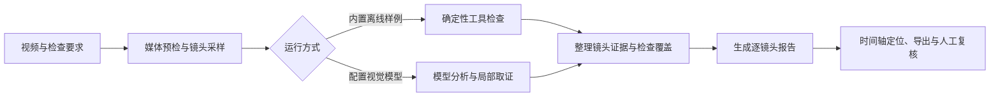
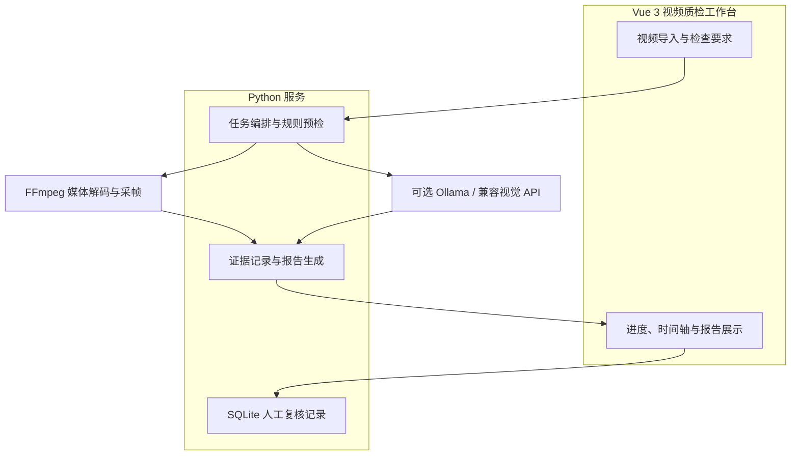

# FrameProof｜多模态视频质检 Agent

**把视频质检过程变成可定位、可追溯、可复核的工程流程。**

[打开在线体验](https://2shanliang1.github.io/frameproof-agent/) · [查看项目源码](https://github.com/2SHANLIANG1/frameproof-agent)

FrameProof 是一个可本地运行的视频质检工作台。它接收视频和自然语言检查要求，执行媒体预检与镜头采样，整理证据并生成逐镜头报告，帮助审阅者快速定位需要复核的画面。

## 项目背景

视频生成和剪辑结果常需要检查角色外观、场景元素等跨镜头一致性。只给出整段视频的单次判断，往往难以说明问题发生在哪个镜头、依据是什么。FrameProof 尝试把检查拆成可追踪的步骤：采样画面、记录观察、对候选问题复核，最后交付带镜头和时间戳的报告。

## 工作流程



## 系统结构



## 项目亮点

- **从视频到报告：** 提供视频导入、检查要求输入、镜头采样、进度展示和报告导出的一体化流程。
- **结果可追溯：** 报告关联镜头、时间戳和采样证据，可从问题定位到对应画面。
- **兼顾可控与可复核：** 使用规则预检、分步取证、重复调用保护和人工复核记录，避免把未覆盖的检查项写成通过。
- **支持本地视觉模型：** 可通过 Ollama 调用本机视觉模型；也提供兼容视觉 API 的适配方式。
- **提供无需模型的体验样例：** 内置离线合成样例，可快速体验检测流程和报告交互。

## 在线体验

在线展示版无需安装，可播放示例视频、查看镜头定位与证据，并下载示例报告。它展示的是已完成运行的结果，不支持上传视频或在线实时推理。

## 技术栈

**前端：** Vue 3、Composition API、Vite

**后端：** Python、HTTP API、SQLite

**媒体处理：** FFmpeg

**模型接入：** Ollama、本地视觉模型及兼容 API

## 本地运行

需要 Python 3.10–3.12。Windows 可双击 `start.bat`；也可以在项目目录运行：

```bash
python -m venv .venv
# Windows
.venv\Scripts\python -m pip install -r requirements.txt
.venv\Scripts\python server.py
# macOS / Linux
.venv/bin/python -m pip install -r requirements.txt
.venv/bin/python server.py
```

启动后访问 `http://127.0.0.1:8765`。本地视觉模型为可选配置；不配置模型也可以体验内置离线样例。

## 项目边界

离线检测仅针对内置合成样例，不代表通用视觉理解能力。真实视频的语义检查依赖所配置的视觉模型，并且只覆盖实际采样画面；检测结果用于辅助审阅，仍需结合证据人工判断。当前版本不提供自动镜头切分或 ASR 音画同步检测。

## License

MIT
