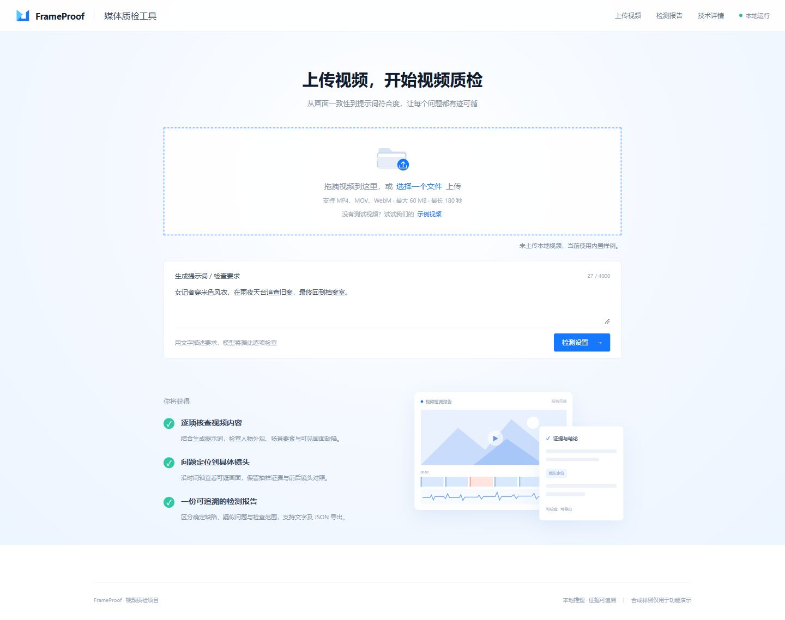
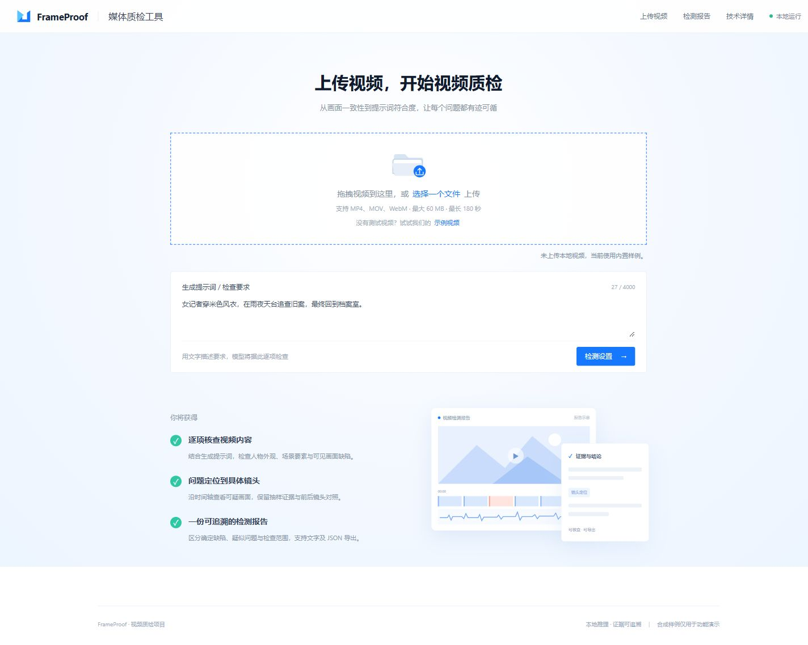
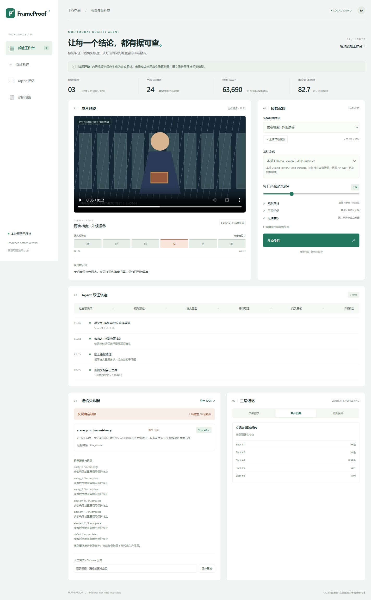
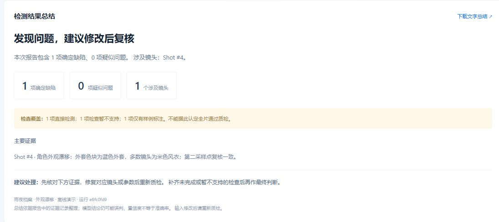

# FrameProof · 多模态视频质检 Agent

**一个可以本地运行、展示取证过程、导出逐镜头报告的视频质检作品。**

前端：**Vue 3 + Composition API + Vite**；后端：Python 视频处理、任务调度与 Ollama 模型适配。Vue 源码位于 `frontend/`，构建页面位于 `web/`，保留双击启动体验。

**先看效果：** [观看约 25 秒演示](docs/demo-effect.mp4) · [查看真实检测结果](docs/underwater-report.png) · [前端开发说明](docs/FRONTEND.md)

演示短片由本次真实运行的页面截图剪辑，模型等待已压缩，非连续录屏。潜水示例实际运行约 213.5 秒、65 次模型调用；7 项任务完成计划抽样，本次未检出缺陷，结论仅适用于采样画面。完整功能需要在本机运行 Python 与模型服务。

基于“检查项编译 → 规则预检 → 按需取证 → 三层记忆 → 独立复核 → 报告回流”的思路构建。默认无需模型账户即可演示；也提供可配置的视觉模型适配器。



## 30 秒了解项目

视频生成后的质量问题常常需要前后镜头对照，单次问答难以给出可追溯的定位结果。FrameProof 将检查目标分解成子问题，用工具读取视频，在实体档案和证据台账中累积观察，并将结果定位到镜头时间轴。

这是**个人演示工程**，不是生产平台或论文结果复现。默认示例为用户提供的“深海潜水 · 生物发光洞穴”，位于 `examples/underwater/`，并预填对应提示词。另保留 3 条合成短片，用于外观漂移、正常对照、黑帧拦截的离线回归。没有附带参考材料中的内部数据或未经复现的指标。

## 快速启动

需要 Python **3.10–3.12**；推荐 3.12。仓库已包含构建后的 Vue 前端，直接演示无需 Node.js；修改前端源码时使用 Node.js 24 和 pnpm。首次安装依赖需要联网，安装后离线演示不需要联网。FFmpeg 随 `imageio-ffmpeg` 安装，无需单独配置。

**Windows：双击 `start.bat`**，等待提示 ready 后打开：

```text
http://127.0.0.1:8765
```

或使用终端：

```powershell
python -m venv .venv
.venv\Scripts\python -m pip install -r requirements.txt
.venv\Scripts\python server.py
```

macOS / Linux：

```bash
python3 -m venv .venv
.venv/bin/python -m pip install -r requirements.txt
.venv/bin/python server.py
```

默认仅监听本机地址。端口被占用时使用 `python server.py --port 8766`。关闭服务终端或按 Ctrl+C 停止。

## 上传自己的视频与输入提示词

首页点击「选择一个文件」或拖入视频，在上传区下方的「生成提示词 / 检查要求」直接输入文字。上传后展开视频预览与检测设置；也可点击「示例视频」体验。无需编辑 JSON。上传限制为 60MB / 180 秒；先输入的提示词在上传完成后会保留。

选择运行方式后，点击下方「开始质检」。只有需要自定义镜头切分时才展开「高级设置：镜头表（可选）」。



## 本地 Ollama / 千问视觉模型

支持直接接入本机 `qwen3-vl:8b-instruct`，无需 API Key：

```powershell
powershell -NoProfile -ExecutionPolicy Bypass -File scripts/setup-ollama.ps1
```

重启服务后页面检测本机模型，并默认选择“本机 Ollama”。实际模型调用有 Token 与耗时统计。详情见 [Ollama 接入与排查](docs/OLLAMA.md)。模型约 6.1GB，权重不随 GitHub 源码分发。



本机指令版端到端记录见 [实际报告](docs/ollama-live-report.json)。此次合成样例耗时 82.67 秒，35 次模型调用，记录了 63,690 token；有检查项因预算或重复调用保护而未完成，不代表全片覆盖或生产准确率。

## 怎么演示

以下为可重复的离线演示；配置 Ollama 后先切到“离线演示”。真实模型的结论与耗时以当次运行为准。

1. 点击“示例视频”打开默认潜水示例；如需离线演示，在“当前视频 / 切换样例”中选“雨夜档案 · 外观漂移”，再点击“开始质检”。
2. 等待真实解码、规则预检、24 帧网格与逐镜头色块测量完成。
3. 报告定位 **Shot #4 / 00:06**；点击镜头跳转到视频对应位置。
4. 切换“实体档案”，对照米色与蓝色外套；切换“证据台账”，查看采样区间和测量记录。
5. 导出 JSON，输入人工复核意见并保存。
6. 选“黑帧拦截”，展示无需调用模型即可提前出报告；选“正常对照”，展示不会因缺少完整语义检查而误报“全片通过”。

详细讲解见 [三分钟演示与面试说明](docs/DEMO_GUIDE.md)。

## 已实现的能力与边界

| 模块 | 本项目实现 | 边界 |
|---|---|---|
| 媒体工具 | FFmpeg 实际解码、网格拼接、时间戳、真实音轨 RMS | 最多 180 秒 / 60 MB / 60 镜头 |
| 规则预检 | 四点黑帧采样、连续镜头静音、分辨率、镜头表终点检查 | 采样可能漏掉短暂黑帧；规则不能替代逐帧检测 |
| 离线控制器 | 确定性工具编排，第二采样点复核合成外套色块 | 仅针对已知合成几何，不是通用视觉理解 |
| 真实模型 | 本地 Ollama 或外部 HTTPS；要素编译、网格速写、JSON 决策、局部视觉探针 | 本地记录见验证文档；未验证云端 Key |
| 三层记忆 | 最新焦点、实体属性观测、完整台账；有界摘要与缓冲清空 | 冲突保留给控制器处理，不做复杂实体消歧 |
| Harness | 子问题步数上限、动作/镜头校验、重复调用阻断、低置信度复核 | 单任务本地执行；没有分布式队列和自动重试 |
| 结果 | 确定/疑似分区、未覆盖维度、镜头跳转、JSON 导出 | 置信度不代表统计准确率 |
| 回流 | SQLite 保存人工复核，独立于合成评测 | 尚无标注审核后台或自动模板学习 |
| 音频 | 静音能量预检 | **未接 ASR，不宣称音画错位检测** |

上传自己的视频后，默认按时长等分成最多 6 段，这不是自动镜头检测。可展开“高级设置：镜头表（可选）”填写真实镜头边界。用户视频在离线模式仅做规则和采帧，不会伪造语义结论。

## 连接外部视觉模型（可选）

默认示例配置面向 Ollama。如需外部服务，在 `.env` 填写：

```dotenv
QC_ENABLE_LIVE=1
QC_PROVIDER=openai_compatible
QC_API_BASE=https://your-provider.example/v1
QC_API_KEY=your-key
QC_MODEL=your-vision-model
QC_ENHANCED_MODEL=your-stronger-vision-model
```

重启后在界面选择“真实视觉模型”。模型服务必须支持 `/chat/completions`、`image_url` 的 JPEG data URL 和 JSON 文本输出。模型名称由使用者按其账户可用能力填写，不预设特定厂商或版本。`QC_ENHANCED_MODEL` 留空时同模型复核，不代表自动获得更强推理能力。

真实模式会将提示词、元信息和抽样帧发送到配置的服务商，并产生其计费；API Key 始终保留在服务端。每次取证使用两组不同时间点的帧，只有匹配且置信度达阈值的缺陷进入确定区，未达阈值的候选再调用配置的增强模型复核。第二组单独检出的候选保留在疑似区。不同采样调用不保证统计独立。API 失败会明确结束任务，不会自动切换成离线成功结果。

Token 来自服务返回的 usage，含编译、圈选、控制、探针和复核。服务不返回 usage 时显示“未知”；离线模式无模型调用，Token 为 0。每个子问题最多 8 次控制决策，每个 probe 含两次视觉请求和必要的复核，预算不是总 API 调用数。低置信度阈值 0.6 为演示配置，未经生产标定。

## 检测结果总结

结果区先展示总体结论、确定/疑似数量、涉及镜头、主要证据、检查覆盖与建议处理，再列出逐镜头诊断。总结由已归档证据整理，未完成、暂不支持或仅抽样检查不会被解释为全片通过。JSON 含 `summary` 字段，并可下载 UTF-8 文字总结。

检测完成后自动跳转到结果；完成报告保留运行链接，刷新页面可恢复。旧报告读取时也会依据其原有证据补充总结。



## 工程结构

```text
server.py               本地 HTTP API、任务调度、上传、报告与复核
qc/engine.py            编译器、规则、记忆、预算控制、复核与报告
qc/media.py             视频生成、解码、自适应采样、拼图与音频测量
qc/provider.py          可选视觉 API 适配器与 usage 记录
frontend/               Vue 3 单文件组件、共享 composable、Vite 与前端测试
examples/underwater/    默认潜水视频、预览图、提示词和等长分段镜头表
web/                    Vite 构建结果，由 Python 同源提供
tests/                  解码回归、元信息校验、记忆、预算等测试
scripts/evaluate.py     三条合成样例的可复现冒烟评测
docs/                   架构、演示指南与本机验证记录
data/                   自动生成的视频、报告与复核库（Git 忽略）
```

架构和设计取舍见 [ARCHITECTURE.md](docs/ARCHITECTURE.md)。

## 前端开发

后端保持运行。在 `frontend/` 目录执行：

```powershell
pnpm install --frozen-lockfile
pnpm dev
```

开发地址为 `http://127.0.0.1:5173/`，支持热更新。运行 `pnpm test` 验证前端逻辑，运行 `pnpm build` 更新 `web/`，然后在 `http://127.0.0.1:8765/` 使用构建版。组件划分、环境要求与代理说明见 [FRONTEND.md](docs/FRONTEND.md)。

## 测试与评测

```powershell
.venv\Scripts\python -m pip install -r requirements-dev.txt
.venv\Scripts\python -m pytest -q
.venv\Scripts\python scripts/evaluate.py
```

评测输出保存在 `data/evaluation/summary.json`。每条样例根据实际预测镜头集合与合成金标计算集合 F1；三个受控样例只能用于回归检查，不能推断真实视频质量、性能提升、生产覆盖率或泛化能力。GitHub Actions 已配置 Vue 前端测试与构建，以及 Python 3.12 测试；本机验证记录见 [VALIDATION.md](docs/VALIDATION.md)。

## 上传 GitHub

从本目录初始化 Git 并推送到你创建的空仓库即可。不要上传 `.venv`、`.env`、`data/` 或用户视频；项目已配置 `.gitignore`。首次启动会自动生成样例。推荐仓库名 `frameproof-agent`，描述可用：

> Evidence-first video QC agent demo with structured memory, local media tools and an inspectable review workflow.

本地网页依赖 Python 后端，不能直接使用 GitHub Pages 托管完整功能。GitHub 仓库可通过截图、说明和一键启动脚本供 HR 审阅。若要对公网提供体验，需要另做鉴权、存储隔离、限流和部署。

## 项目来源与声明

参考用户提供的多模态取证 Agent 设计材料，重新编写可运行的个人演示工程。原始 PDF 未打包或提交，未复制材料中的内部评测集、业务业绩或实验数值。MIT 许可覆盖本仓库代码与自行生成的素材；不覆盖第三方模型服务和其输出的独立许可条款。
