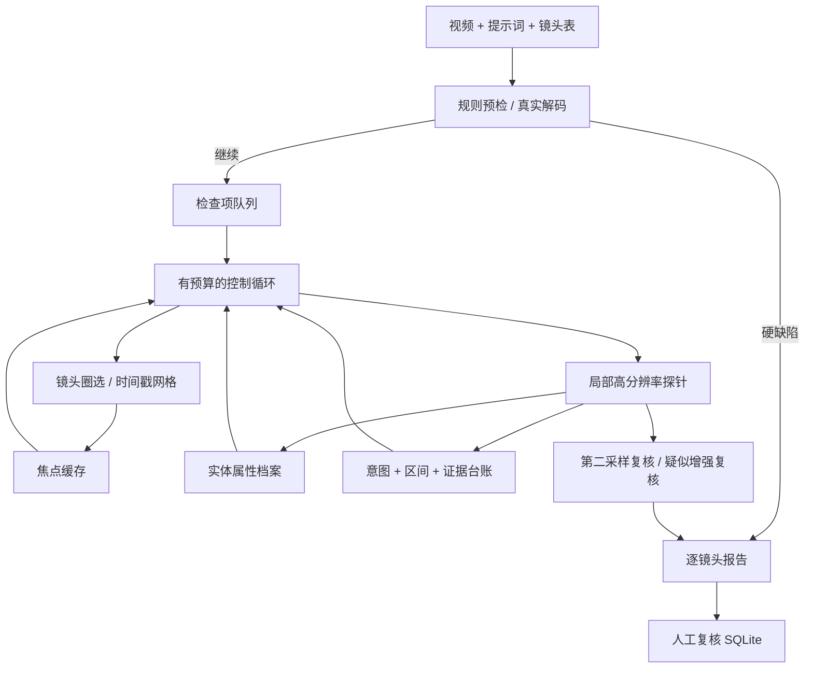

# 架构与设计取舍

## 前端

使用 Vue 3 单文件组件和 Composition API。App 组装上传、视频配置、报告、技术详情四个组件；应用级 useInspection composable 管理选中视频、提示词、检测状态、事件、历史报告和下载资源，通过 provide/inject 共享。模板插值负责安全显示模型文本，v-model 和事件绑定驱动交互，不再通过字符串拼接修改页面。

Vite 开发服务通过本机代理访问 Python，构建时输出到 web/，运行版由 Python 同源提供带哈希的 JS/CSS 文件，不依赖 CDN。轮询与上传请求携带 AbortSignal，Vue 作用域销毁时清理轮询、请求和 Blob URL。前端开发方式见 FRONTEND.md。

更完整的输入到输出流程与本地模型控制循环见 [项目完整工作流程](WORKFLOW.md)。

## 模式分离

真实推理支持两个后端：Ollama 原生 `/api/chat` 使用本机回环地址，无需 API Key；外部后端保留 HTTPS Chat Completions 协议。本地请求使用 JSON Schema 限制动作、镜头编号和缺陷类型，设置 16384 上下文并记录实际 Token。模型名称随报告保存，避免混淆离线、Ollama 与外部模型结果。

离线模式是可重复的确定性工具编排。合成视频的外套区域已知，颜色来自解码图像像素，不读取 `expected_defect_shots` 来生成结果；该字段仅供独立评测使用。场景语义仅有生成时的标签，明确标成 annotation_only。真实模式则通过视觉模型编译实体与提示词要素、生成网格速写，并由模型选择局部探针目标。

## 三层记忆

- focus_cache：最近一次圈选的区间、网格路径、采样帧数与真实模式速写。
- entity_cards：按实体/属性保存镜头、观测值、置信度，允许冲突并存。
- ledger：每次工具动作的可公开目的、区间和结构化输出，保存完整证据链。

probe_buffer 只暂存本轮图像。工具输出归档后清空。控制器读取不超过 6000 字符的摘要，不将原始图像和完整历史反复拼接到文本上下文；旧记录仍保留在磁盘报告中。摘要先压缩旧输出，极端超长再截断文本，因此摘要是可读文本，不保证为完整 JSON。大规模实体档案还需要查询式读取，这是后续扩展点。

## 预算与结论

每个子问题 1–8 个控制步骤。模型动作仅接受 probe 或 ANSWER，探针只接受镜头表内最多四个镜头。重复镜头调用会阻断；步数耗尽、未取证即回答或检查未支持均不能导出为全片通过。

probe 进行两次不同时间点采样。缺陷需镜头和类型匹配且双方置信度达阈值才能成为确定项。增强复核保留三方最低置信度，不把一次高分覆盖低分。确认区内仅代表当前证据符合演示规则，不保证模型结论正确。相同镜头、相同类型跨任务去重，选择置信度更高的观测。

## 服务设计

使用标准库 HTTP 服务减少启动依赖；它适合本机演示。视频 Range 请求支持时间轴跳转；所有写请求要求本地来源与自定义请求头。上传有大小和时长限制，文件使用随机 ID，不信任客户端文件名。运行互斥防止本机过载，后台线程运行视频分析，前端轮询获取公开事件。运行中任务在内存，完成报告在磁盘；服务重启后可按已知运行 ID 读取报告，但暂不提供历史列表。

用户自定义镜头表必须有唯一 ID、有限时间边界、无重叠，结束时间不能大幅越界；预检同时检查实际视频时长和分辨率。静音规则仅在实际含音轨、元信息声明需要音频且镜头超过五秒时执行。

## 有意保留的边界

没有伪造 ASR、生产评测、模型准确率或部署吞吐。当前不含人物重识别专用模型、复杂时间对齐、自动场景切分、云存储与多租户队列。后续可依次扩展真实镜头检测、ASR 时间戳工具、公开数据集评测，再考虑并发服务部署。
