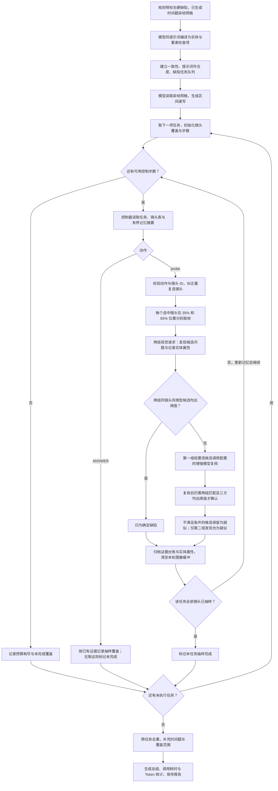

# 项目完整工作流程

本页说明现有程序如何从视频和提示词产生可追溯的检测报告。总体输入、离线分支和结果交付见 [仓库首页流程图](../README.md#项目工作流程)。下图展开本地 Ollama 模式的取证循环。

## 本地模型取证与复核

控制决策、镜头范围、模型返回格式或 API 调用出错时，任务以失败状态结束，前端显示错误。不会自动切换为离线成功结果。每项任务最多使用配置的 1–8 个控制步骤；每次 probe 可选择最多 4 个镜头，控制步数不等于模型请求次数。

“确定缺陷”表示当前证据满足程序的确认规则；双组采样不保证统计独立，模型置信度也不等于准确率。增强模型未单独配置时使用同一模型。连续动作、瞬时缺陷和音画同步不能通过当前静帧流程保证。

## 模块与交付物

| 阶段 | 主要代码 | 产生的结果 |
|---|---|---|
| 输入与检测配置 | `frontend/src/components/UploadPanel.vue`、`VideoWorkspace.vue` | 视频、提示词、镜头表、运行模式、步数预算 |
| 上传、校验与后台运行 | `server.py` | 随机视频 ID、运行 ID、事件与状态 |
| 解码、采样与网格 | `qc/media.py` | 元信息、带时间戳采帧网格、局部静帧、音轨测量 |
| 任务编排与规则预检 | `qc/engine.py` | 检查队列、硬缺陷、取证动作与覆盖记录 |
| 模型适配 | `qc/provider.py` | Ollama / 可选外部 API 的结构化响应及 usage |
| 共享记忆 | `qc/engine.py` 中的 `QCMemory` | 焦点缓存、实体属性档案、完整证据台账 |
| 报告整理 | `qc/engine.py`、`qc/reporting.py` | 去重后的确定/疑似问题、覆盖范围、总结、`report.json` |
| 展示与导出 | `InspectionReport.vue`、`TechnicalDetails.vue`、`useInspection.js` | 轮询进度、时间轴跳转、记忆查看、TXT / JSON 下载 |
| 复核留存 | `server.py` 的反馈接口 | 本地 `data/feedback.sqlite3`；当前没有自动学习流程 |

报告保存到本机 `data/runs/`，已完成的报告可按运行 ID 恢复。上传视频、运行报告、复核数据库与模型权重不随源码提交 GitHub。
